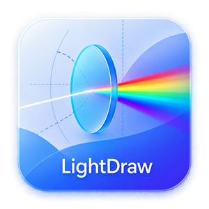
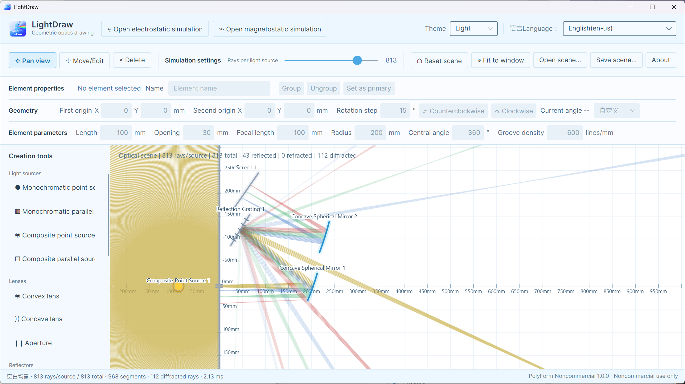
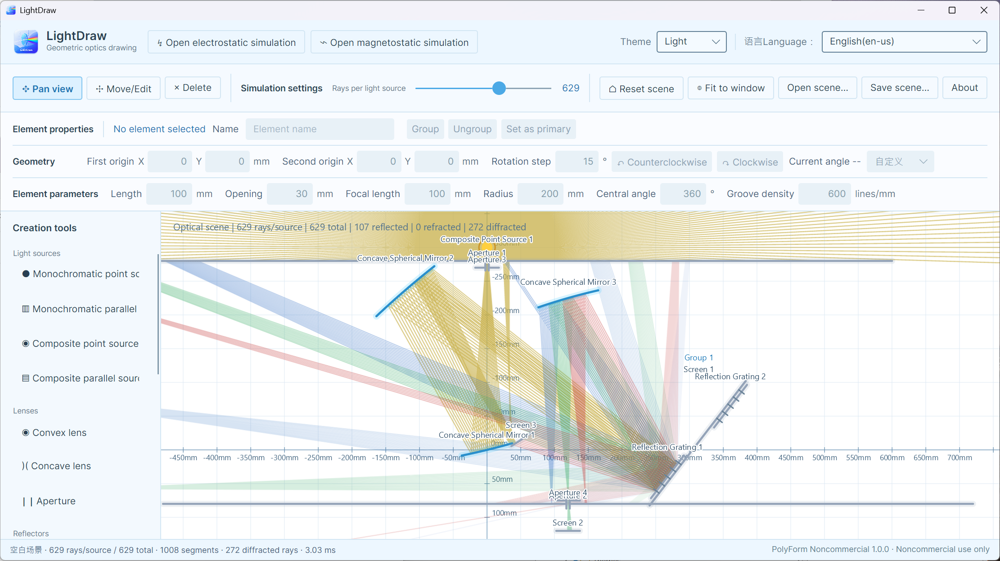
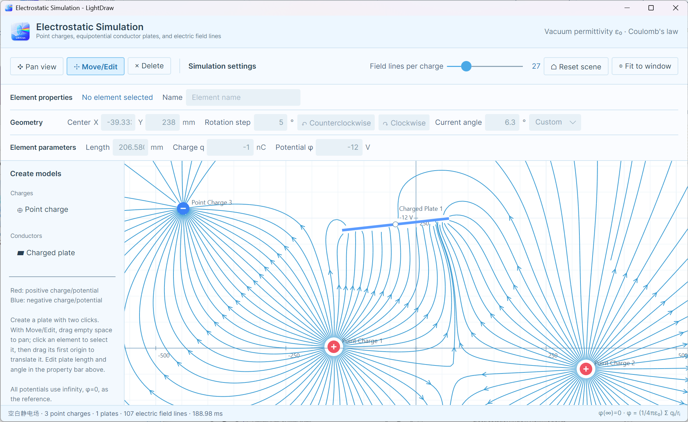
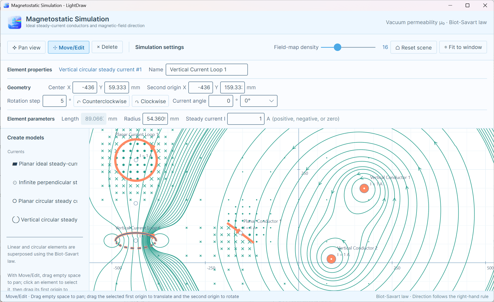

  

<h1 align="center">LightDraw · 光绘课堂</h1>

  Build physics scenes on a canvas and bring rays and field lines into view.

  <a href="https://lightdraw.martinphysics.club/"><strong>Try it online</strong></a>
  ·
  <a href="https://github.com/MatinxHT/LightDraw/releases"><strong>Download for desktop</strong></a>
  ·
  <a href="https://apps.microsoft.com/detail/9P9JGS0LB77D?hl=en-us&amp;ocid=pdpshare">Microsoft Store</a>

<a href="README.md">简体中文</a> · English

LightDraw is a 2D drawing and simulation tool for physics lessons and demonstrations. Teachers can illustrate physical phenomena, while students build scenes, adjust parameters, observe changes, and test their ideas.

## Explore physics

### Geometric optics

Place light sources, lenses, mirrors, beam splitters, gratings, and more. Adjust their positions and properties to observe reflection, refraction, diffraction, and dispersion. Ray paths update as you edit the scene.

See another optical scene

 

### Electrostatics and magnetostatics

In the desktop app, place point charges, charged plates, conductors, and current loops to explore how electric and magnetic fields change with their positions, orientations, and parameters.

<table>
  <tr>
    <td width="50%" valign="top">
      <strong>Electrostatics</strong> 
      Electric field lines around point charges and a charged plate 
      
    </td>
    <td width="50%" valign="top">
      <strong>Magnetostatics</strong> 
      Magnetic fields from conductors and current loops 
      
    </td>
  </tr>
</table>

Screenshots show the desktop app; the interface may vary by version or language setting.

## Get started

- **Browser:** [Open LightDraw](https://lightdraw.martinphysics.club/) to explore geometric optics without installing anything. Calculations run in your browser, and scene files do not need to be uploaded. A desktop browser is recommended.
- **Desktop:** Install the Windows app from the [Microsoft Store](https://apps.microsoft.com/detail/9P9JGS0LB77D?hl=en-us&ocid=pdpshare), or download a portable package from [GitHub Releases](https://github.com/MatinxHT/LightDraw/releases). Packages are available for Windows and Linux on x64 / ARM64, and macOS on Apple silicon.

Choose a tool and place elements on the canvas, then use **Move/Edit** and the properties panel to adjust the scene. You can undo and redo edits, save or open `.lightdraw.json` scenes, and export an optics canvas as a PNG. Geometric optics scene files work in both the browser and desktop editions. The interface supports English and Simplified Chinese, with light and dark themes.

The simulations are intended for teaching and conceptual demonstrations, not precision engineering or professional decisions.

## Documentation and contributing

- [User guide](docs/guide.en.md): tools, scene management, and shortcuts.
- [Technical reference](docs/technical.en.md): builds and releases, scene formats, simulation methods, and architecture.
- [Contributing guide](CONTRIBUTING.en.md) · [Test notes](tests/README.md)

LightDraw uses .NET, Avalonia, and SkiaSharp, with simulation logic separated from the interface. Classroom ideas, issue reports, documentation improvements, and code contributions are welcome through Issues and Pull Requests.

## License and acknowledgements

LightDraw is licensed under the [PolyForm Noncommercial License 1.0.0](LICENSE), which permits non-commercial use only; commercial use requires separate permission. It is source-available and is not open source under the OSI definition.

LightDraw was inspired by [Ray Optics Simulation](https://github.com/ricktu288/ray-optics). Thanks to its author and contributors. LightDraw is an independent project and has no official affiliation or endorsement.
