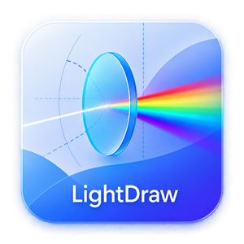
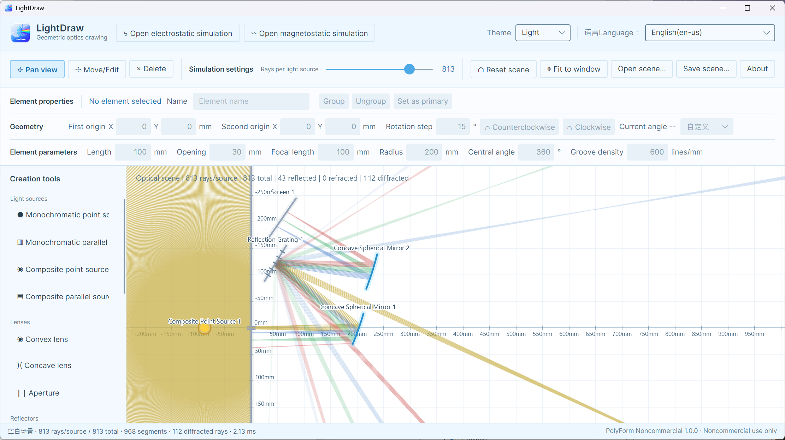
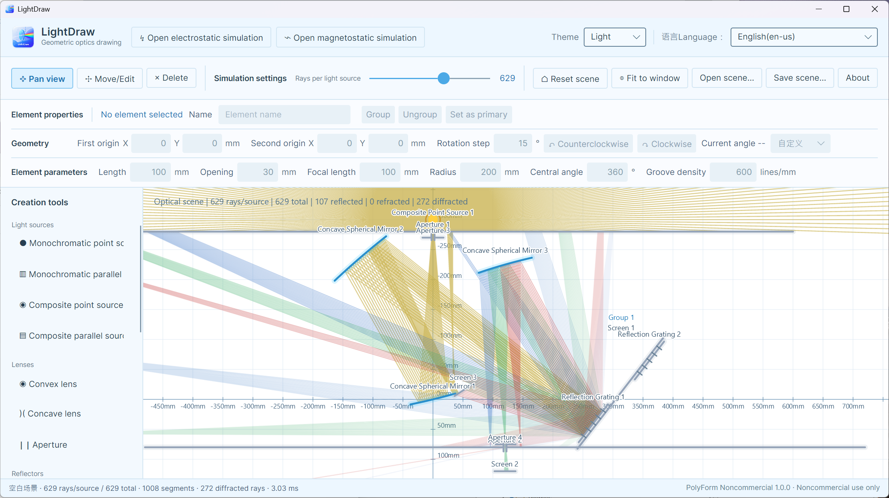
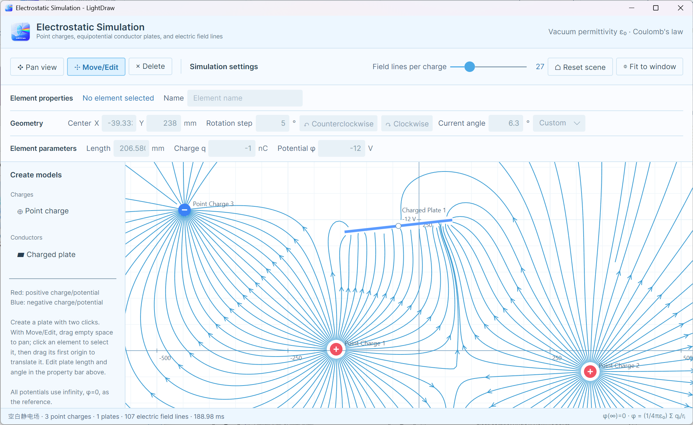
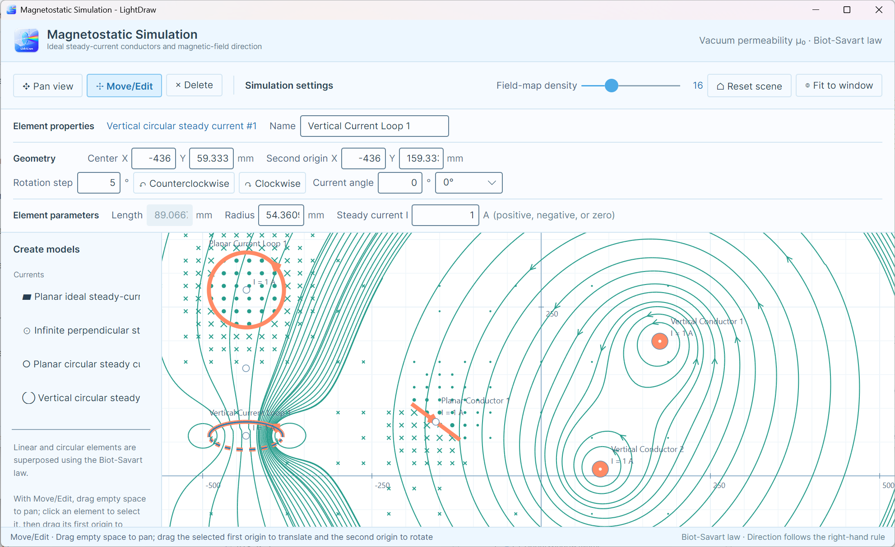

  

<h1 align="center">光绘课堂 · LightDraw</h1>

  在画布上搭建物理场景，让光路与场线直观可见。

  <a href="https://lightdraw.martinphysics.club/"><strong>在线体验</strong></a>
  ·
  <a href="https://github.com/MatinxHT/LightDraw/releases"><strong>下载桌面版</strong></a>
  ·
  <a href="https://apps.microsoft.com/detail/9P9JGS0LB77D?hl=zh-cn&amp;gl=CN&amp;ocid=pdpshare">Microsoft Store</a>

简体中文 · <a href="README.en.md">English</a>

光绘课堂是一款面向物理课堂和实验演示的二维绘图与模拟工具。教师可以用它展示物理现象，学生也可以动手搭建场景、调整参数，观察变化并验证想法。

## 探索物理现象

### 几何光学

放置光源、透镜、反射镜、分光镜和光栅等元件，调整位置与参数，观察光线的反射、折射、衍射和色散。光路会随场景编辑实时更新。

查看更多几何光学场景

 

### 静电场与静磁场

在桌面版中，放置点电荷、带电平板、导线和圆形电流，观察电场线和磁场随位置、方向与参数的变化。

<table>
  <tr>
    <td width="50%" valign="top">
      <strong>静电场</strong> 
      点电荷与带电平板周围的电场线 
      
    </td>
    <td width="50%" valign="top">
      <strong>静磁场</strong> 
      导线与圆形电流产生的磁场 
      
    </td>
  </tr>
</table>

截图展示的是桌面版界面，实际界面可能随版本或语言设置有所不同。

## 开始使用

- **浏览器版**：[直接打开 LightDraw](https://lightdraw.martinphysics.club/)，无需安装即可体验几何光学。计算在浏览器中完成，场景文件无需上传；建议使用桌面浏览器。
- **桌面版**：从 [Microsoft Store](https://apps.microsoft.com/detail/9P9JGS0LB77D?hl=zh-cn&gl=CN&ocid=pdpshare) 安装 Windows 版，或从 [GitHub Releases](https://github.com/MatinxHT/LightDraw/releases) 下载便携包。便携包支持 Windows 和 Linux 的 x64 / ARM64，以及搭载 Apple 芯片的 macOS。

选择工具并在画布上放置元件，再通过“移动/编辑”和属性栏调整场景。可以撤销和重做、保存或打开 `.lightdraw.json` 场景；几何光学画布还可以导出为 PNG。浏览器版与桌面版可以互相打开几何光学场景文件。界面支持简体中文、英语及明暗主题。

模拟主要用于课堂教学与概念演示，不应作为精密工程计算或专业决策的依据。

## 文档与参与

- [使用参考](docs/guide.md)：工具操作、场景管理与快捷键。
- [技术参考](docs/technical.md)：构建发布、场景格式、模拟方法与项目架构。
- [贡献指南](CONTRIBUTING.md) · [测试说明](tests/README.md)

项目使用 .NET、Avalonia 和 SkiaSharp，模拟核心与界面分离。欢迎通过 Issue 或 Pull Request 分享课堂需求、反馈问题、改进文档或参与开发。

## 许可与致谢

本项目采用 [PolyForm Noncommercial License 1.0.0](LICENSE)，仅授权非商业用途；商业使用须另获授权。光绘课堂是源码可用项目，不属于 OSI 定义的开源软件。

光绘课堂的创作灵感来自 [Ray Optics Simulation](https://github.com/ricktu288/ray-optics)，感谢该项目的作者与贡献者。LightDraw 是独立项目，与其没有官方隶属或背书关系。
